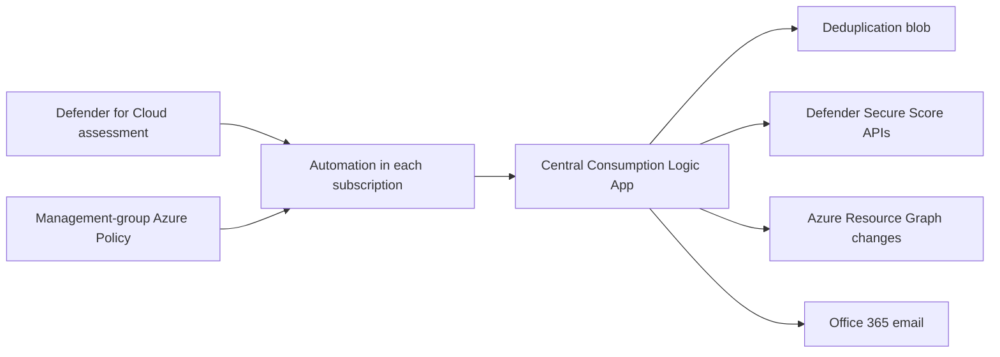

# Defender for Cloud recommendation email playbook

Management-group-scale Azure deployment that emails a detailed notification whenever Microsoft Defender for Cloud raises an **unhealthy top-level security recommendation**. It covers every current and future subscription under the deployment management group and all supported recommendation names and severities.

[](https://portal.azure.com/#blade/Microsoft_Azure_CreateUIDef/CustomDeploymentBlade/uri/https%3A%2F%2Fraw.githubusercontent.com%2Foguzhanf%2Fdefender-for-cloud-recommendation-email-playbook%2Fmain%2Fazuredeploy.json/uiFormDefinitionUri/https%3A%2F%2Fraw.githubusercontent.com%2Foguzhanf%2Fdefender-for-cloud-recommendation-email-playbook%2Fmain%2FuiFormDefinition.json)

## What is deployed



- A central Consumption Logic App with a system-assigned managed identity.
- An Office 365 Outlook API connection for sending mail.
- A private StorageV2 account used only for deduplication markers.
- Microsoft built-in policy **Deploy Workflow Automation for Microsoft Defender for Cloud recommendations** (`73d6ab6c-2475-4850-afd6-43795f3492ef`) assigned at management-group scope.
- A remediation task that creates one `Microsoft.Security/automations` resource in every existing subscription. The policy covers future subscriptions automatically.
- Management-group Reader and Security Reader access for the Logic App identity, plus the RBAC required by the policy assignment identity.

The automation selects:

- All recommendation IDs.
- High, Medium, and Low severities.
- `Unhealthy` state, so notifications represent active recommendations that require remediation.

## Prerequisites

- Microsoft Defender for Cloud enabled on the governed subscriptions.
- A management group containing all subscriptions to govern. Select the tenant root management group to cover the full tenant.
- A central Azure subscription under your control.
- A Microsoft 365 mailbox permitted to authorize the Office 365 Outlook connector.
- Deployment identity with:
  - Permission to create deployments at the target management group, including `Microsoft.Resources/deployments/validate/action`.
  - Owner or User Access Administrator plus resource deployment permissions at the target management group.
  - Owner or equivalent permissions in the central subscription.

## Deploy

1. Select **Deploy to Azure** above.
2. Select the management group to govern. Select the tenant root management group to cover the full tenant.
3. Select the central subscription and Azure region from their pickers.
4. Enter the notification recipients and optional CC recipients.
5. Create the deployment. Existing subscriptions are remediated automatically.
6. Authorize the Office 365 connection once:

   ```powershell
   .\scripts\authorize-office365.ps1 `
     -SubscriptionId <central-subscription-id> `
     -ResourceGroupName rg-mdc-recommendation-email `
     -ConnectionName office365-mdc-recommendations
   ```

   In the Azure portal page that opens, select **Edit API connection**, select **Authorize**, sign in to the sender mailbox, and save.

7. Allow Azure Policy evaluation and remediation to finish. Defender assessment events are evaluation-driven and aren't guaranteed to be instantaneous.

### CLI deployment

```powershell
.\scripts\deploy.ps1 `
  -ManagementGroupId <management-group-id> `
  -CentralSubscriptionId <subscription-id> `
  -NotificationEmailAddresses 'security@contoso.com;cloudops@contoso.com'
```

Use `-Preview` first if you want a management-group deployment preview.

## Email contents

Each message includes:

- Recommendation name, severity, state, cause, description, remediation guidance, assessment type, preview status, categories, threats, implementation effort, user impact, policy definition, and portal link.
- Subscription and affected resource identifiers.
- Recent Azure Resource Manager changes for the resource from Change Analysis, over a configurable lookback window.
- Current classic Secure Score for the affected subscription.
- Current weighted classic Secure Score for the selected management group.
- A best-effort estimate of the maximum score difference attributable to the affected resource when the recommendation maps to a scored built-in control.
- The complete Defender event payload as a JSON attachment.

The email states explicitly that sending a notification changes Secure Score by **0 points**. The estimate describes the finding's possible resource-level contribution, not an immediate forecast.

## Acceptance test

See [docs/acceptance-test.md](docs/acceptance-test.md), or dispatch the included sample:

```powershell
.\scripts\test-notification.ps1 `
  -SubscriptionId <central-subscription-id> `
  -ResourceGroupName rg-mdc-recommendation-email `
  -LogicAppName la-mdc-recommendation-email `
  -AffectedResourceId /subscriptions/<subscription-id>/resourceGroups/<rg>/providers/<type>/<name>
```

Use a real Azure resource ID under the governed management group so enrichment can return subscription, Secure Score, and change data. Delete the matching marker blob or wait for retention expiry before resending the identical event.

## Important behavior and limitations

- **Top-level recommendations:** Defender workflow automation uses the `Assessments` event source. Nested sub-assessments, such as individual vulnerability findings, don't each trigger this workflow; their parent recommendation can trigger when its assessment changes.
- **Evaluation timing:** workflow automation fires when Defender evaluates or updates an assessment. Existing recommendations can fire during the next evaluation pass.
- **Change correlation:** the recommendation payload doesn't provide a guaranteed configuration before/after diff. Resource Graph Change Analysis is included as best-effort correlation and must not be treated as proof of causation.
- **Secure Score:** only generally available built-in Microsoft cloud security benchmark recommendations affect classic Secure Score. Controls normally recalculate about every eight hours. The newer risk-based Cloud Secure Score in the Defender portal is a different model and isn't projected here.
- **Deduplication:** repeated events for the same resource, assessment, and state are suppressed for 30 days by default. Storage failures don't suppress the email; the message flags the deduplication failure.
- **OAuth:** ARM can create the Office 365 connection but cannot complete delegated user consent. One interactive authorization is required.
- **Policy remediation:** RBAC propagation can cause transient remediation failures immediately after deployment. Retry the remediation task after several minutes if needed.

## Repository layout

| Path | Purpose |
|---|---|
| `azuredeploy.bicep` / `azuredeploy.json` | Management-group deployment and Deploy to Azure artifact |
| `uiFormDefinition.json` | Azure portal form with management-group, subscription, and region pickers |
| `infra/modules/` | Central subscription, Logic App, policy, RBAC, and remediation modules |
| `logicapp/workflow.json` | Logic App workflow definition |
| `samples/recommendation-event.json` | Synthetic Defender recommendation event |
| `scripts/` | Deployment, authorization, validation, and test helpers |

## Validate locally

```powershell
.\scripts\validate.ps1
```

The script validates JSON, recompiles Bicep, and checks the generated management-group template. Azure-side validation additionally requires access to the target scopes.

## Microsoft references

- [Workflow Automation in Microsoft Defender for Cloud](https://learn.microsoft.com/azure/defender-for-cloud/workflow-automations)
- [Microsoft.Security/automations template reference](https://learn.microsoft.com/azure/templates/microsoft.security/automations)
- [Defender recommendation Logic Apps connector schema](https://learn.microsoft.com/connectors/ascassessment/)
- [Cloud Secure Score calculation](https://learn.microsoft.com/azure/defender-for-cloud/secure-score-security-controls)
- [Secure Scores REST API](https://learn.microsoft.com/rest/api/defenderforcloud/secure-scores/get)
- [Secure Score control definitions REST API](https://learn.microsoft.com/rest/api/defenderforcloud/secure-score-control-definitions/list)
- [Azure Resource Graph resource changes](https://learn.microsoft.com/azure/governance/resource-graph/changes/get-resource-changes)
- [Deploy to Azure button](https://learn.microsoft.com/azure/azure-resource-manager/templates/deploy-to-azure-button)
- [Azure portal Form view](https://learn.microsoft.com/azure/azure-resource-manager/templates/form-view-overview)

## License

[MIT](LICENSE)
